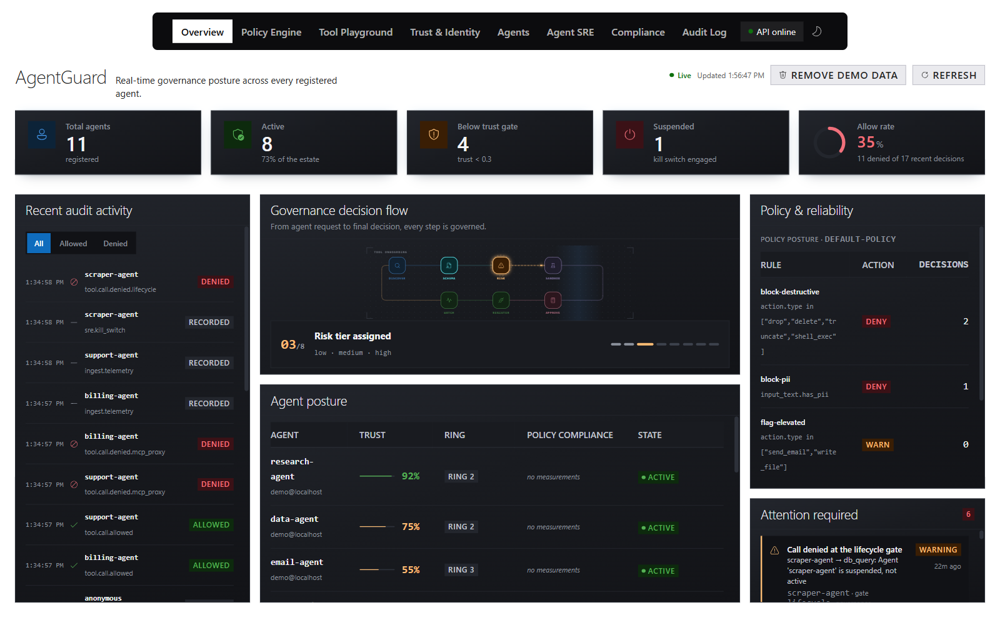

# AgentGuard

**Govern every agent. Prove every call.**

AgentGuard is a local playground for the [Microsoft Agent Governance Toolkit](https://microsoft.github.io/agent-governance-toolkit/) (AGT). Use its React dashboard and FastAPI API to register agents, author policies, exercise governed tool calls, connect MCP servers, and inspect the resulting reliability metrics and evidence.

> **Learning playground, not a production governance product.** Enforcement uses real AGT primitives, but some integrations are observational or advisory. Compliance reports are self-assessments, not certifications.
>
> **Unofficial project.** AgentGuard is not affiliated with, endorsed by, or supported by Microsoft. The integration currently targets `agent-governance-toolkit[full]~=4.1.0`, a public-preview release line.

## Dashboard preview



*Captured from the running application with demo data loaded. Totals reflect that instance's existing state; warnings and denied calls are intentional parts of the scenario.*

## What is included

| Tab | What you can do |
|---|---|
| **Overview** | Inspect agent posture, recent decisions, policy activity, reliability, and alerts. |
| **Policy Engine** | Create and edit policies, build conditions, inspect YAML and inheritance, evaluate inputs, and dry-run changes against recorded contexts. |
| **Tool Playground** | Run governed calls, register webhook tools, and discover/import remote or local MCP tools. |
| **Trust & Identity** | Evaluate enforced trust, inspect computed reputation, and verify signed agent cards. |
| **Agents** | Register agents, inspect lifecycle history, suspend/resume agents, and link Foundry telemetry. |
| **Agent SRE** | Inspect SLOs, error budgets, burn rates, alerts, and behavioural anomalies; exercise the kill switch and adversarial evaluation. |
| **Compliance** | Inspect live control coverage, framework assessments, MCP controls, and system-prompt defensive posture. |
| **Audit Log** | Inspect events, verify the audit chain and MCP receipts, export evidence, and open or compare decision traces. |

**There is no separate Telemetry tab in this version.** Reliability telemetry lives in **Agent SRE**; audit evidence, MCP receipts, and decision traces live in **Audit Log**.

### Local services

| Service | Address | When it runs |
|---|---|---|
| React dashboard | http://localhost:3000 | Frontend development server |
| FastAPI backend | http://127.0.0.1:8000 | Backend process |
| Interactive API docs | http://127.0.0.1:8000/docs | Served by the backend |
| Bundled demo MCP server | `http://127.0.0.1:8931/mcp` | Started inside the backend on `POST /demo/seed`, or separately for development |

SLOs, alerting, anomaly detection, tracing, and receipt generation run inside the backend. The local demo does **not** require a separate collector, Grafana, Prometheus, database server, Azure subscription, or model API key.

## Run locally

### Prerequisites

- Python **3.11+** with `venv` and `pip`.
- Node.js **18+** and npm.
- Free ports **3000**, **8000**, and **8931**.
- Internet access for the initial dependency installation.

### Windows: manual startup

Use this path when you want explicit control over configuration and do not want the launcher to reset the audit chain. Run each server in its own PowerShell terminal, starting from the project root.

**Terminal 1 - backend**

```powershell
Set-Location .\backend
if (-not (Test-Path .\.venv\Scripts\python.exe)) {
    python -m venv .venv
}
.\.venv\Scripts\python.exe -m pip install -r requirements.txt

$env:AGT_STATE_DIR = Join-Path (Get-Location) 'state'
$env:AGT_TOOL_ALLOW_PRIVATE = '1'
.\.venv\Scripts\python.exe -m uvicorn main:app --host 127.0.0.1 --port 8000
```

`AGT_STATE_DIR` enables persistent agent state, SLO measurements, and decision traces. `AGT_TOOL_ALLOW_PRIVATE=1` permits local/private tool endpoints for this playground; do not carry that setting into an untrusted deployment.

**Terminal 2 - frontend**

```powershell
Set-Location .\frontend
npm ci
$env:BROWSER = 'none'
$env:REACT_APP_API_URL = 'http://127.0.0.1:8000'
npm start
```

Dependency installation is only needed on initial setup or after dependencies change. Open **http://localhost:3000**, select **Get started**, then load the demo below.

The backend binds to loopback. The CRA development server uses its default host configuration and may also listen on network interfaces; use it only on a trusted development machine. Stop each server with **Ctrl+C**.

### Windows: one-command demo launcher

```powershell
.\start.bat
```

The [Windows launcher](start.bat) sets up dependencies, starts the API with durable state, loads demo data, and opens the dashboard.

> **Audit reset:** `start.bat` and `seed.bat` call `DELETE /audit` before seeding. Use the manual startup and `POST /demo/seed` below when you want to preserve the currently loaded chain. Neither script is an authenticated production launcher.

### macOS / Linux

From the project root:

```bash
export AGT_STATE_DIR="$PWD/backend/state"
export AGT_TOOL_ALLOW_PRIVATE=1
bash start.sh
```

The [shell launcher](start.sh) installs dependencies and starts both servers. Unlike the Windows launcher, it does **not** seed the full scenario automatically. Use **Load demo data** in Overview once the API is ready. Press **Ctrl+C** to stop both servers.

## Load demo data

From **Overview**, select **Load demo data**, or use a separate PowerShell terminal:

```powershell
Invoke-RestMethod 'http://127.0.0.1:8000/health'
$demo = Invoke-RestMethod -Method Post `
    -Uri 'http://127.0.0.1:8000/demo/seed' -TimeoutSec 120
$demo | Select-Object loaded, calls, receipts, traces_enabled, gates_exercised, surprises
$demo.mcp
```

When authentication is enabled, supply an admin bearer token with the request.

The scenario:

- Registers five scenario agents with different trust scores and adds the four Tool Playground preset agents when absent.
- Adds `finance-policy`, which inherits from `default-policy`.
- Runs allowed and denied calls through the real lifecycle, trust, ring, and policy gates.
- Starts the bundled MCP server, imports four tools, and exercises the MCP proxy gate with signed receipts.
- Ingests sample execution telemetry and suspends `scraper-agent` to demonstrate the kill switch.
- Captures decision traces when `AGT_STATE_DIR` is configured.

These are sample inputs, **not fabricated audit rows**: actual governance decisions produce the events, alerts, SLO measurements, traces, and receipts.

For the default local configuration, check:

- `loaded` and `traces_enabled` are `true`.
- `surprises` is empty.
- `mcp.skipped` is `null`, and four MCP tools were imported.
- `gates_exercised` includes `lifecycle`, `trust`, `ring`, `policy`, and `mcp_proxy`.

Re-running the endpoint reuses scenario agents and appends new activity; it does not clear the audit chain. Existing state and repeated runs change totals. Stricter authentication, approval, attestation, or MCP settings can intentionally change demo outcomes.

**Warning and critical alerts are expected.** The demo deliberately triggers denials and error-budget burn. An empty anomaly list is also valid: the detector needs enough history and a deviation to report a finding.

**Remove demo data** decommissions the scenario agents and removes its policy and imported server. It does not erase historical audit evidence. The Audit Log's **New chain** action is a separate, explicit reset.

For terminal-driven scenarios, see [seed_demo.py](backend/seed_demo.py). Unlike the in-process endpoint, that client requires a separately running demo MCP server to exercise the MCP portion.

## Verify the application and telemetry

HTTP health alone does not establish that every telemetry subsystem is working. Check both the APIs and their rendered panels.

```powershell
$base = 'http://127.0.0.1:8000'
Invoke-RestMethod "$base/health"
Invoke-RestMethod "$base/sre/slos"
Invoke-RestMethod "$base/sre/alerts"
Invoke-RestMethod "$base/sre/anomalies"
Invoke-RestMethod "$base/traces?limit=5"
Invoke-RestMethod "$base/audit/verify"
Invoke-RestMethod "$base/mcp/receipts/verify"

$controls = (Invoke-RestMethod "$base/compliance/owasp").runtime_controls
$controls | Select-Object sre_alerting, sre_anomaly_detection, call_tracing, `
    durable_state, durable_slo, degraded_subsystems
```

With the recommended configuration:

| Check | Expected result |
|---|---|
| Health | `status: "ok"` |
| Agent SRE | Scenario agents have measurements; alerts show the deliberately denied calls |
| Runtime controls | `sre_alerting`, `sre_anomaly_detection`, and `call_tracing` are `true`; `degraded_subsystems` is empty |
| Traces | `enabled: true`, with recorded calls and readable span details |
| Audit verification | `valid: true` |
| Receipt verification | `valid: true`, with receipts from the MCP scenario |
| Browser | **API online**, all eight tabs load, and Audit Log verification buttons succeed |

Telemetry failures are logged and surfaced as degraded controls rather than silently reported as healthy. See [observability.py](backend/observability.py).

### Troubleshooting

| Symptom | Check or action |
|---|---|
| **API offline** | Confirm `/health` responds, port 8000 is free, and the frontend API URL matches the backend. Restart the frontend after changing `REACT_APP_API_URL`. |
| CRA reports `options.allowedHosts[0] should be a non-empty string` after setting `HOST=127.0.0.1` | Remove the override with `Remove-Item Env:HOST -ErrorAction SilentlyContinue`, then rerun `npm start` with its default host configuration. Do not disable host checks to hide the error. |
| Empty decision traces | Set `AGT_STATE_DIR` **before** starting the backend, then generate new calls. |
| Empty MCP receipts | Inspect the seed response's `mcp.skipped` field and confirm port 8931 is available. Receipts require MCP calls, not native-tool-only traffic. |
| No data on a particular SLO | Generate calls for that agent. Existing agents are not all exercised by the demo, and measurement windows expire. |
| `401` or `403` responses | Supply a token with the required role; demo loading requires admin. |
| Alerts show critical/warning while services respond | Inspect the alert source. Demo governance denials are not server outages; check `degraded_subsystems` separately. |
| Audit/receipt lists empty after a backend restart | Their in-memory ledgers restart empty. Reload demo traffic; durable state does not persist every subsystem. |

## How governance works

The API runs four main decision gates, plus an MCP-specific gate. Denials identify the gate and rule that stopped the call.

| Gate | Responsibility |
|---|---|
| **Lifecycle** | Only registered, active agents may proceed. Suspension is the enforced kill switch. |
| **Trust** | Enforces the shared trust policy; the default minimum is `0.3`. |
| **Ring** | AGT restricts resources according to the agent's execution ring. |
| **Policy** | The same `PolicyEngine` backs policy evaluation and actual governed calls. |
| **MCP proxy** | Applies argument scanning, descriptor-derived trust requirements, per-tool rate limits, and quarantine before MCP dispatch. |

Identity, tenant, optional caller-session/signature, and other admission checks also run where applicable. These are not bypassed by an allow rule.

- Trust above `0.60` selects `RING_2_STANDARD`; lower scores select `RING_3_SANDBOX`, subject to the earlier trust gate. Ring 1 requires consensus this playground does not provide.
- Tool-category and transport evidence supplement AGT's action-name resource inference, including subprocess restrictions for local stdio tools.
- A tool without an endpoint receives a **decision only**. A configured webhook or MCP tool is actually dispatched after the gates allow it.
- Computed reputation is advisory until an operator promotes it into the enforced trust score.
- Anomaly detection alerts on observed deviations; it does not itself block a call.
- Optional Hypervisor sessions can narrow a participant's permissions, never expand them. Reversibility grades are available to policies, not an automatic undo mechanism.

### Policies

Policies are YAML files under [backend/policies](backend/policies), configurable with `AGT_POLICY_DIR`. The UI supports condition building, authored/resolved views, inheritance, and shadow evaluation.

- A child policy cannot weaken an inherited deny. The resolved view identifies rule origins and dropped overrides.
- Supported conflict strategies include `deny_overrides`, `allow_overrides`, `priority_first_match`, and `most_specific_wins`.
- Higher numeric priorities run first. Policy `scope` affects `most_specific_wins`.
- AGT's condition grammar is deliberately limited: comparisons, membership, truthiness, and `and`/`or`; not general Python or regex.
- **`warn` is blocking** in this integration: only an `allow` decision is allowed.
- Rules outside `pre_tool` are not evaluated by the governed tool-call path; the editor warns about them.
- Shadow evaluation never enforces a draft. Comparisons requiring input text absent from the audit record are reported as uncertain.

See the [user guide](user_guide.md) for policy authoring and panel walkthroughs.

### MCP integration

AgentGuard supports **Streamable HTTP**, legacy **HTTP+SSE**, and explicit local **stdio** servers. Automatic transport discovery never falls back to launching a process.

Controls include descriptor risk/category evaluation, server authentication admission, package-vulnerability checks, per-agent sliding-window budgets, parameter sanitisation, rug-pull detection, response scanning, and signed receipts. Response blocking is the default; optional sanitisation is re-scanned before content is returned.

Public remote servers must satisfy the configured authentication policy. Private-address exemptions and local-server execution have separate boundaries. Online CVE lookup is opt-in; an offline or unqueried package must not be interpreted as vulnerability-free.

Caller authentication sessions and signed-call replay protection are optional and distinct from Hypervisor collaboration sessions. Their current configuration is exposed through `GET /mcp/controls`.

See the [demo MCP server guide](demo_mcp_server.md) and the implementation modules [admission](backend/mcp_admission.py), [limits](backend/mcp_limits.py), and [caller authentication](backend/mcp_caller_auth.py).

## Configuration and persistence

Set backend variables before starting the API.

| Variable | Purpose |
|---|---|
| `AGT_STATE_DIR` | Durable agent metadata, public identities, tool registry, SLO measurements, traces, and platform signing keys |
| `AGT_POLICY_DIR` | Override the policy-file directory |
| `AGT_TOOL_ALLOW_PRIVATE` | Permit private/loopback tool and MCP endpoints for trusted local development |
| `AGT_API_KEYS` / `AGT_API_KEYS_FILE` | Enable API-key authentication; inline entries use `token:subject:tenant:roles` |
| `AGT_CORS_ORIGINS` | Allowed browser origins; defaults include the local dashboard |
| `AGT_REQUIRE_ATTESTATION` | Require cryptographic agent attestation |
| `AGT_REQUIRE_APPROVAL` | Require admin approval before a new agent becomes active |
| `AGT_JWT_SECRET` | Enable static HS256 JWT validation; optional issuer/audience checks use `AGT_JWT_ISSUER` / `AGT_JWT_AUDIENCE` |
| `AGT_AUDIT_FILE` + `AGT_AUDIT_KEY` | Append an HMAC-signed audit file, independently verifiable through `/audit/verify-file` |
| `AGT_RECEIPT_KEY` | Pin the platform receipt-signing seed; otherwise generated and persisted when a state directory is configured |
| `AGT_MCP_AUTH_STRICT` | Apply remote authentication requirements to private addresses too |
| `AGT_MCP_CVE_ONLINE` | Opt into online package-vulnerability lookup |
| `AGT_MCP_MAX_CALLS_PER_WINDOW` / `AGT_MCP_WINDOW_SECONDS` | Configure per-agent MCP call budgets |
| `AGT_MCP_RESPONSE_POLICY` | Configure MCP response handling |
| `AGT_REQUIRE_MCP_SESSION` / `AGT_REQUIRE_CALL_SIGNATURE` | Require caller-session authentication or signed-call replay protection |
| `AGT_LOG_LEVEL` / `AGT_LOG_FORMAT` | Operational logging, separate from audit evidence |
| `REACT_APP_API_URL` | Frontend build-time API base; an empty value uses the same origin |

### What survives a restart

| Data | Persistence |
|---|---|
| Policies | File-backed independently of `AGT_STATE_DIR` |
| Agent records, trust/tenant metadata, public identities, tool registrations | Persist with `AGT_STATE_DIR` |
| SLO measurements and decision traces | Persist with `AGT_STATE_DIR`; traces are disabled without it |
| Platform signing keys | Can persist or be explicitly configured; this does not persist the receipt ledger |
| In-memory audit chain and MCP receipt ledger | Start empty on restart |
| Signed audit file | Opt-in append-only output; not an automatic reload of the in-memory chain |
| Alert/anomaly history, runtime sessions, and rate-limit counters | Process-local |

**Protect state directories and never commit them or their signing keys.** Agent private keys are issued once at registration and are not retained by the platform; callers must store their own keys securely.

Authentication is **off by default**, granting anonymous local-admin access. With authentication enabled, roles are `viewer`, `operator`, and `admin`, and supported resources are tenant-scoped. The frontend can read a bearer token from `localStorage['agt_api_token']`; do not bake credentials into `REACT_APP_*` variables, because those values are embedded in the downloadable JavaScript bundle.

## Connect your own agent

There are two different integration modes:

1. **Inline governance:** call `POST /tools/call` before acting. The API decides whether the operation is allowed and dispatches configured tools.
2. **Observational telemetry:** call `POST /ingest/events` to report execution that already happened. This feeds SLOs and source-tagged audit records; it cannot retroactively enforce policy.

[backend/agt_client.py](backend/agt_client.py) provides a dependency-free client for registration, attestation, governed requests, and telemetry.

For **Microsoft Foundry**, register a linked agent in the Agents panel, export its run-step JSON from Foundry, then select **Sync from Foundry** and paste the steps. `POST /agents/{id}/foundry/sync` maps `tool_calls` steps into telemetry. The backend does not call the Foundry SDK or host the Foundry agent.

### API reference

The running [OpenAPI documentation](http://127.0.0.1:8000/docs) is the authoritative reference for request bodies and endpoint permissions.

| Area | Representative endpoints |
|---|---|
| Status and demo | `/health`, `/stats`, `/demo/seed` |
| Agents and identity | `/agents`, `/agents/{id}/identity`, `/agents/{id}/card`, `/identity/challenge` |
| Policies and tools | `/policies`, `/policies/evaluate`, `/policies/shadow`, `/tools/register`, `/tools/call` |
| MCP | `/mcp/discover`, `/mcp/import`, `/mcp/servers`, `/mcp/controls`, `/mcp/receipts` |
| Telemetry and reliability | `/ingest/events`, `/sre/slos`, `/sre/alerts`, `/sre/anomalies`, `/sre/chaos/run` |
| Audit and traces | `/audit`, `/audit/verify`, `/audit/verify-file`, `/audit/export/accountability`, `/traces`, `/traces/diff` |
| Compliance and sessions | `/compliance/owasp`, `/compliance/report`, `/compliance/acs`, `/sessions` |

## Development and tests

**Backend**, from the project root:

```powershell
Set-Location .\backend
.\.venv\Scripts\python.exe -m pip install -r requirements-dev.txt
.\.venv\Scripts\python.exe -m pytest
```

**Frontend**, in a separate terminal from the project root:

```powershell
Set-Location .\frontend
npm test
npm run build
```

The backend suite covers governance gates, identity, authorization, persistence, policies, MCP transports and controls, telemetry, audit integrity, and traces. Frontend tests use Node's test runner; the production build validates the React bundle.

The AGT compatible-release pin is intentional: some integrations use toolkit internals. Test before widening it. Legacy top-level AGT import names remain in use; the application suppresses the known package-consolidation notice, not all deprecation warnings.

## Container and Azure deployment

The [Dockerfile](Dockerfile) builds the React bundle and serves it alongside FastAPI from one origin on port 8000.

```powershell
docker build -t agentguard .
docker run --rm -p 127.0.0.1:8000:8000 agentguard
```

Open **http://localhost:8000** for this mode, not port 3000. Supply persistent writable storage and runtime secrets explicitly when needed; the default container has neither durable audit configuration nor authentication.

[azure.yaml](azure.yaml) and [infra](infra) define an Azure Container Apps deployment with a private registry and managed-identity image pulls.

> **Do not run `azd up` with an empty authentication configuration.** The supplied template uses external ingress, and an unconfigured API is an anonymous-admin API. Configure `AGT_API_KEYS` and the appropriate `AGT_CORS_ORIGINS` as azd environment values before deployment, or change ingress to private. Keep secrets out of source control.

The template deliberately uses **one replica**. Governance state, audit ledgers, sessions, and rate-limit budgets are not shared across processes; additional replicas or workers would produce inconsistent decisions and evidence.

## Boundaries and limitations

- **Not production isolation.** Execution-ring checks restrict permitted resources; they are not an OS sandbox for arbitrary third-party code. Local stdio servers execute on the host.
- **Attestation is optional by default.** An unattested `agent_id` is self-asserted and reported as `identity_verified: false`. SPIFFE/mTLS identity binding and full OIDC/JWKS key rotation are not implemented.
- **Outbound URL checks have limits.** Private/loopback targets and redirects are guarded, but pre-flight DNS checks do not close the DNS-rebinding window. Treat tool registration as a trusted operation.
- **Telemetry is not enforcement.** Ingested and Foundry events are self-reported observations. Synthetic SLO-button measurements are labelled separately.
- **Compliance is evidence-based self-assessment.** Missing controls and unexercised attack categories are not a pass. A system-prompt grade measures defensive wording, not malicious user-input detection.
- **Trace timing is measured, not inferred.** Ring, policy, and MCP proxy share AGT's `govern` span; remote dispatch and evidence writes have separate measured spans.
- **Verification is point-in-time.** `/stats` may use cached chain verification; `/audit/verify` performs a fresh check.
- **Adversarial results may include breaches.** A runnable evaluation is not a guarantee that every vector is blocked.

## Project map and further reading

| Path | Purpose |
|---|---|
| [backend/main.py](backend/main.py) | FastAPI routes and governed execution |
| [backend/demo_seed.py](backend/demo_seed.py) | Shared demo scenario |
| [backend/config](backend/config) | MCP and prompt-injection detection rules |
| [backend/tests](backend/tests) | Backend regression tests |
| [frontend/src](frontend/src) | React application, API client, and panels |
| [docs/images](docs/images) | README UI screenshot |
| [user_guide.md](user_guide.md) | Detailed user workflows |
| [demo_mcp_server.md](demo_mcp_server.md) | Bundled MCP server walkthrough |
| [explain.md](explain.md) | Additional project explanation |

Contributions should preserve the shared policy/enforcement path, distinguish observed telemetry from authoritative decisions, and make unsupported or degraded controls explicit.
